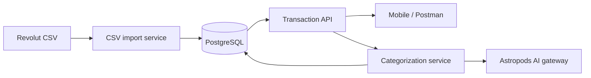

# Bank Insights · Backend

Java 25 LTS / Spring Boot API for importing personal bank statements, browsing stored
transactions, and reviewing AI category suggestions. Companion:
[React Native / Expo app](https://github.com/zbybko/bank-insights-mobile).

## Current behavior

- Revolut CSV import keeps `COMPLETED` rows and preserves exact amounts and fees.
- PostgreSQL stores transactions and imports; Flyway owns schema migrations.
- SHA-256 deduplication prevents importing identical file bytes twice, including
  under another filename. Overlapping or edited exports are **not** deduplicated
  at the transaction level yet.
- AI enrichment is an explicit request through the Astropods gateway. Uncertain
  suggestions keep the actual category `UNCATEGORIZED` and ask a question.
- Manual confirmation records `categorySource=USER`, closes the review, and keeps
  the original AI suggestion. Sequential enrichment skips AI and USER records.



## Local setup

Income classification and user-confirmed history are described in
[Income memory](docs/INCOME_MEMORY.md), including the opt-in AI endpoints and
local gateway simulation. Salary-based budget periods are not implemented yet.

Requires JDK 25 and Docker Desktop. Commands run from this repository root.
On macOS select the JDK for your terminal before running Maven:

```bash
export JAVA_HOME=$(/usr/libexec/java_home -v 25)
export PATH="$JAVA_HOME/bin:$PATH"
./mvnw --version
```

The Maven version output must show Java 25. In VS Code, use **Java: Configure
Java Runtime** to select a JDK 25 installation for this project. The extension's
bundled runtime is separate from the project's JDK. CI also builds with Temurin 25.

1. Copy `.env.example` to `.env` and fill in local values. Keep real exports in
   the ignored `data/` directory.
2. Start PostgreSQL: `docker compose up -d postgres`.
3. In VS Code select **Start Backend**. Its launch configuration reads `.env`.
   For a terminal launch, export the variables into your shell first, then run
   `./mvnw spring-boot:run`. Spring Boot does not load `.env` automatically.

Flyway applies migrations on startup; Hibernate validates the schema.
Never edit an applied migration: create a new version. Migration file changes
are excluded from DevTools restart triggers; other changes may still restart
Spring and run Flyway.

The default development server listens on port 8080 and binds to `0.0.0.0` for
phone testing. There is no authentication yet. Use `SERVER_ADDRESS=127.0.0.1` for
loopback-only development and synthetic data for shared demos.

### Import a statement

Run with the `csv-import-check` Spring profile to import the configured
`REVOLUT_CSV_PATH` and check that importing it again adds no rows. For example,
append `--spring.profiles.active=csv-import-check` to the VS Code launch `args`.
Remove the profile after checking. Import does not call AI.

The `dev` package also retains opt-in `db-check` (saves a synthetic transaction)
and `ai-check` (sends a synthetic transaction to the model and may use credits).
These manual runners are separate from automated tests.

## API

| Method | Path | Behavior |
| --- | --- | --- |
| GET | `/api/transactions/summary?month=YYYY-MM` | Currency-separated monthly money in, money out, net flow and category spending |
| GET | `/api/transactions` | All stored transactions, newest booking date first, UUID descending for ties |
| POST | `/api/transactions/{id}/enrichment` | Classify an unclassified record; return existing AI/USER classification otherwise |
| PATCH | `/api/transactions/{id}/category` | Confirm or correct a category with `{"category":"GROCERIES"}` |

Malformed UUIDs, malformed JSON and invalid/missing categories return 400.
Missing transaction IDs return 404. The API currently returns entity JSON;
amount and fee are decimal strings. `bookingDate` has no timezone because the
CSV does not supply one. `categorizedAt` is an instant in UTC.

Review fields: `category`, `suggestedCategory`, `categorySource`,
`categoryExplanation`, `categoryReviewRequired`, `categoryQuestion`, and
`categorizedAt`. Review fields may be null before classification. A tentative
suggestion is not a confirmed category.

[Postman collection and usage](postman/README.md).

## Tests

```bash
./mvnw test
# Includes a disposable PostgreSQL 18 container; Docker must be running:
./mvnw clean verify -Pintegration-tests
```

Unit and standalone MockMvc tests cover CSV parsing, category states, AI response
validation, service guards, JSON serialization and HTTP errors. Integration tests
apply all Flyway migrations to a fresh PostgreSQL database, check identical-file
imports and persisted review state, and verify rollback on an insert failure.
All fixtures are synthetic. Automated tests use no real bank exports or AI keys
and make no live model calls. CI runs the full suite on pushes and pull requests.

## Packages

- `transaction`: entity, repository, category enums and HTTP API.
- `categorization`: suggestion contract, model output validation and enrichment.
- `csv`: Revolut parsing, import tracking and atomic ingestion.
- `integration.astropods`: gateway HTTP client.
- `dev`: explicitly selected manual check profiles.

[Architecture and limitations](docs/ARCHITECTURE.md) ·
[Development workflow](CONTRIBUTING.md)

Monthly summary uses completed booking dates with an inclusive month start and exclusive next-month start. Money in includes positive transfers and refunds; it is not verified salary. Fees remain separate. `shareBasisPoints` is the rounded share of outgoing payments (10000 = 100%). Local Expo web origins on ports 8081 and 8082 are allowed by default; override with `WEB_ALLOWED_ORIGINS`.
