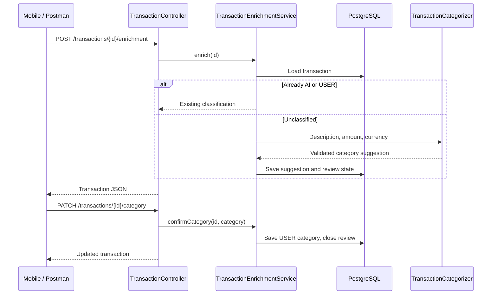

# Backend architecture

One Spring Boot application, one PostgreSQL database, and a separate mobile
repository. Packages group related behavior; they are not separate services.
`BackendApplication` stays at the root package so Spring discovers all children.

## Ingestion

`csv.RevolutCsvParser` reads UTF-8 named CSV columns, keeps completed rows, parses
money as `BigDecimal` and dates as timezone-free `LocalDateTime`, then sorts by
booking date descending. Amount and fee remain separate.

`csv.CsvImportService` reads the bytes once, hashes them with SHA-256, and looks
up the import record. For new content it parses rows, persists the import,
attaches its ID to every transaction, and saves them in one database transaction.
Any exception rolls back the whole import. The unique file hash also prevents
duplicate import records under concurrent attempts, but a losing concurrent
request is not yet converted into an idempotent success response.

Identical bytes are deduplicated. Changed or overlapping exports can still
produce duplicate transactions. Account identity and per-transaction source keys
remain future work.

## Categorization and user review

The model gateway is accessed through `integration.astropods.AstropodsClient`.
The Java categorizer supplies its own prompt; the separate TypeScript sandbox's
agent instructions do not control Java requests. Model output must have exactly
four fields with valid types and consistent question/review states.

A review-required suggestion leaves the actual category `UNCATEGORIZED`.
User confirmation changes the actual category, preserves `suggestedCategory`,
and removes the pending question. It does not create a merchant-wide rule.
Model data is a suggestion; it does not change monetary facts.

Sequential calls preserve user choices. There is no optimistic locking yet:
a model request racing with a manual correction can overwrite newer data.
Do not interpret the sequential guard as a concurrency guarantee.

## Persistence and API boundaries

JPA entities and repositories live beside their features. Flyway migrations
create the schema; Hibernate runs with `ddl-auto=validate`. HTTP endpoints
currently serialize entities directly. Introduce response DTOs when API and
storage representation need to evolve independently.

GET reads stored data without importing CSV or calling AI. Explicit enrichment
loads a record, calls the model outside a long database transaction, then saves.
Missing IDs are 404; request binding and missing categories produce 400.
Pagination, authentication, account scoping and consistent provider-error
responses remain to be implemented before public deployment.

## Verification

`*Test` classes run with `./mvnw test`, without Docker or provider credentials.
Standalone MockMvc verifies HTTP binding and serialization without a database.
`*IT` classes run under `-Pintegration-tests verify` using Testcontainers and a
fresh PostgreSQL 18 instance. They check migrations, JPA mapping, import
idempotency and atomic rollback. No automated test contacts a live model;
mocked model responses test validation, not model accuracy or gateway availability.

Future analytics must separate currencies and distinguish purchases, transfers
and income. Cash flow is not an account balance. Open Banking eligibility,
production model configuration, authentication and deployment remain open.
