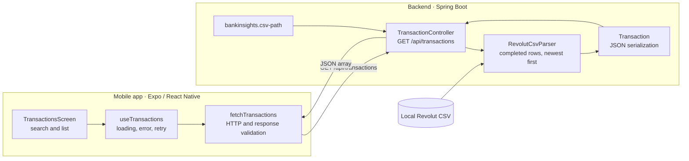
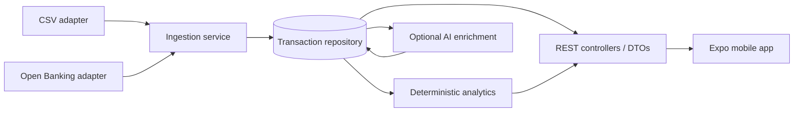

# Architecture: current prototype and proposed direction

## Current implementation

The controller receives a file path from configuration and calls the CSV parser
on every GET. The parser constructs immutable-in-practice `Transaction` objects
(private fields, constructor, getters), filters completed records, parses money
and local timestamps, and sorts them. The class is not yet enforced immutable
with final fields or constructor validation. Jackson annotations currently live
on the same class. Mobile consumes a JSON array.

There is no database, persisted import state, transaction ID, account scope,
authentication, AI provider, or sync worker. This boundary matters when reviewing
claims in either repository's README.

The CSV path is configured on the backend and is never supplied by the mobile
request. The app validates the response shape before displaying transactions.

## Proposed target: one backend application, separate mobile repository

These components are planned, not generated skeletons. Introduce boundaries when
a task needs them; keep one Spring Boot application rather than microservices.

| Responsibility | Boundary |
| --- | --- |
| HTTP | Controllers validate request parameters and map results/errors to DTOs |
| Ingestion | Bank adapters normalize source data; service handles atomic import and identity |
| Persistence | Repository owns reads/writes; database constraints enforce uniqueness |
| Analytics | Java/BigDecimal calculates facts by account, date range and currency |
| Enrichment | AI suggests labels/explanations; user edits and deterministic facts remain authoritative |
| Mobile | Fetch, screen state, navigation, filters, accessible presentation |

The API contract is owned here. Mobile models should match it and validate
untrusted responses; TypeScript types alone do not validate JSON at runtime.

## Decisions already established

- Java/Spring Boot and React Native/Expo are the learning and implementation stack.
- Two Git repositories with reciprocal links, chosen by the user on 2026-10-16.
- Exact decimal money; API decimal strings. Never add EUR and USD together.
- A timezone-free statement timestamp is not an instant in UTC.
- Keep bank-specific adapters so CSV and a future API share ingestion behavior.
- UI, documentation and code identifiers in English; coaching can be in Russian.
- The user writes the application code and makes material architecture choices.

## Decisions still open

Open Banking provider/live eligibility, database, authentication approach, model
provider/default, category taxonomy, and deployment are not selected. For each
material choice, discuss 2–3 feasible options, then write a short ADR recording
the user's decision, alternatives, consequences and evidence.

## Financial correctness to specify before dashboards

- Match Amount/Fee semantics against the bank format before deriving net values.
- Own-account transfers and FX legs require treatment distinct from purchases.
- Preserve raw and normalized descriptions separately when adding normalization.
- Prefer provider stable transaction IDs scoped to an account. CSV identity is
  inherently ambiguous for identical partial exports; document limitations.
- Define pending/completed/reverted transitions before automated ingestion.
- Reconcile category and monthly aggregates to source transactions in tests.

## AI scope

First useful AI feature: category suggestion with correction and review states.
Follow with explanations of backend-calculated trends, then recurring-payment
candidates. Avoid an unrestricted chat assistant as the first feature: there is
no reliable financial grounding or evaluation harness yet.

Keep provider secrets on the server, use synthetic demo data, and make model
calls optional. The app must still browse stored transactions and show exact
summaries when the bank or model provider is unavailable.
