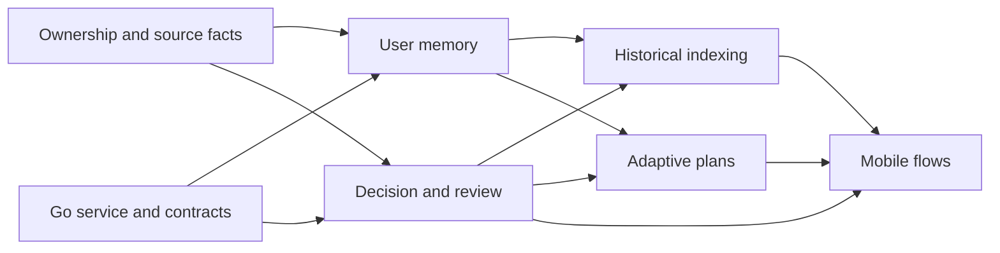

# Intelligence roadmap and next session

Planning snapshot: 2026-10-25. These tasks describe future work, not shipped features.

Epic: [Go intelligence, user memory and adaptive planning](https://github.com/zbybko/bank-insights-backend/issues/6).
Decision: [ADR 0001](adr/0001-go-intelligence-and-user-memory.md).
Current implementation: [income assessment and confirmed history](https://github.com/zbybko/bank-insights-backend/blob/f3a60fd/docs/INCOME_MEMORY.md).

## Work packages

| Order | Task | Completion evidence |
| --- | --- | --- |
| 1 | [#7 Ownership and source facts](https://github.com/zbybko/bank-insights-backend/issues/7) | Owner/account isolation, safe source backfill, supported internal-transfer pairs |
| 2 | [#8 Go service and contracts](https://github.com/zbybko/bank-insights-backend/issues/8) | Java/Go round trip with reliable, versioned delivery |
| 3 | [#9 User memory](https://github.com/zbybko/bank-insights-backend/issues/9) | Confirmed business context retrieved for the correct owner; correction/deletion work |
| 4 | [#11 Decision and review](https://github.com/zbybko/bank-insights-backend/issues/11) | Evidence-backed disagreement and durable user confirmation |
| 5 | [#10 Historical indexing](https://github.com/zbybko/bank-insights-backend/issues/10) | Restart-safe bounded processing with measured progress and provider use |
| 6 | [#12 Adaptive planning](https://github.com/zbybko/bank-insights-backend/issues/12) | Dated scenarios, explicit assumptions and accepted plan versions |
| Alongside contracts | [Mobile #1](https://github.com/zbybko/bank-insights-mobile/issues/1) | Memory controls, questions, progress and plan comparison using the approved design |

## Start here next session

1. Agree on user/account ownership and source provenance (#7). Current `Product`
   identifies a product, not a unique account. Existing imported source fields can
   be null; a duplicate import must not be used as a backfill.
2. Design the #8 Go service contract and choose its repository layout, transport
   and service authentication. No new Go repository has been created yet.
3. Use synthetic data to exercise the first business-memory vertical slice:
   confirmed 3D-printing context -> Etsy payout -> SALES proposal -> user decision.
4. Implement a small end-to-end flow before increasing worker count or backfilling
   multi-year history. Do not run a bulk paid analysis of personal records as a test.

## Decisions already made

- Go service for intelligence; Java remains the financial core and mobile API.
- External inference/embedding APIs initially; no custom model training.
- Structured memory plus vector retrieval, with provenance and owner isolation.
- User confirmation outranks model guesses. A correction is not a reusable rule
  unless the user explicitly requests that scope.
- Immutable bank facts; separate budget-period interpretation.
- Code calculates exact scenarios; AI may challenge scope and assumptions.
- Proposed initial memory technology: PostgreSQL/pgvector. Embedding provider,
  dimensions and broker remain to be selected.
- Initial indexing is asynchronous, resumable and bounded. Progress and unresolved
  reviews are separate concepts. Recent periods are processed first.
- Expected job changes affect proposed future plans; neither historic receipts nor
  accepted budgets are silently rewritten.

## Existing baseline on the enrichment branch

Java has source Type/Product storage for new imports, explicit income enrichment,
user confirmation and retrieval of up to ten earlier matching confirmed incomes.
It does not yet implement vector memory, transfer pairing, salary-based periods,
Go workers or adaptive planning. Existing calendar cash-flow totals still include
all completed positive/negative movements.

Mobile has Expo LAN API detection and reusable liquid-glass controls, including
tap/drag tab selection. Native iPhone behavior still needs device review.

Validation on this snapshot: Java 25 full verification passed (54 unit/HTTP tests
and 7 PostgreSQL integration tests; one opt-in simulation test skipped there).
That simulation test then passed separately through the local Postman gateway
stand-in, whose log recorded the HTTP request. This proves wiring, not model quality.
Postman collection lint passed for all nine requests. Mobile lint/typecheck passed;
the liquid-glass/gesture JS bundle was also exported for iOS earlier in the session.
