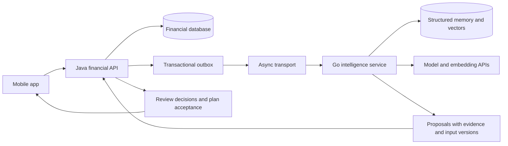
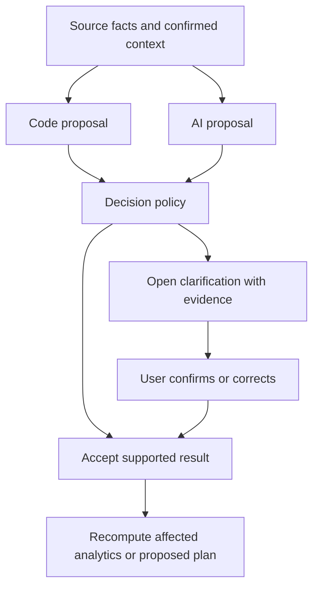
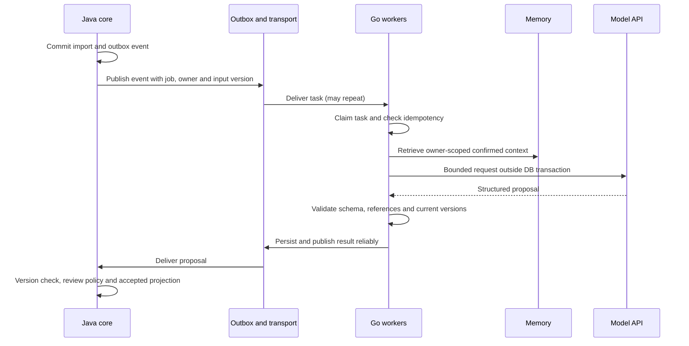

# Go intelligence service and user-owned memory

Status: accepted direction; implementation planned. Date: 2026-10-25.

## Context

Bank Insights is a long-lived personal finance assistant. Transaction labels alone
cannot explain a user's business, employment changes or goals. A marketplace payout
may be business sales rather than a refund. An expected job loss changes forecasts,
not historical receipts. The owner also wants practical microservice experience.

The current implementation is Java/Spring Boot, PostgreSQL and an independent Expo
mobile repository. Java already supports explicit AI income assessment, user
confirmation, source type/product fields and limited retrieval of confirmed history.
There is no Go intelligence service, vector store or durable indexing pipeline yet.

## Decision

Introduce a separately deployable **Go intelligence service**. Use external model
and embedding APIs first. Python/PyTorch and custom model training are not required.
Go is chosen for service development, explicit contracts and bounded concurrent
workers; this is not a claim that Python cannot process requests concurrently.

Keep the existing financial API in Java. The mobile app calls Java; Go does not
write Java's financial tables. Services own separate storage and credentials,
even if development uses one PostgreSQL instance with separate databases.

Select the broker/transport and service repository layout in the foundation task.
Use a transactional outbox, at-least-once delivery and idempotent consumption;
do not assume exactly-once delivery. Define contracts before implementing consumers.

## Ownership

| Java financial core | Go intelligence service |
| --- | --- |
| Transactions, accounts and source provenance | Context assembly and model orchestration |
| Accepted income/spending classifications | AI interpretations and evidence |
| User decisions and explicitly accepted rules | Derived memory and semantic retrieval |
| Accepted goals, budgets and plans | Draft scenarios and plan proposals |
| Exact calculations for a defined scope | Challenges to scope, meaning and assumptions |

User memory mutations enter through Java's authenticated API. Go owns the derived
memory projection and vectors; corrections/deletions are delivered as versioned
events. The ledger remains usable during intelligence outages.

## Memory is more than embeddings

Store structured facts, goals, explicit reusable rules and dated events alongside
retrievable text. Every memory item needs an owner, provenance, confirmation state,
effective time, version and supersession/deletion state. Scope retrieval to the
authenticated owner **before** similarity search. Proposed initial storage is
PostgreSQL with pgvector; provider/model/dimension choices require an explicit
decision and migration plan before implementation.

Examples: a confirmed 3D-printing business is a fact; a specific Etsy payout's
confirmed purpose is a transaction decision; treating future payouts the same way
is a separately approved rule. A possible layoff is a risk, a confirmed last working
day is a dated event, and a three-month unemployment assumption is a scenario.

Retrieved text is evidence, never executable instructions. Transaction descriptions
and third-party content cannot silently become user-confirmed memory. Corrections
must invalidate affected retrieval/results without deleting the decision history.

## Decision policy

Keep source facts, proposals and accepted decisions separate. Agreement between code
and AI is not sufficient proof. Unsupported conclusions remain unknown. Payroll
classification continues to require confirmation until an explicit policy changes.
Keep booking date immutable and budget period separate. Code performs exact
arithmetic; AI may challenge the records, interpretation or assumptions being used.
Late AI results cannot replace a newer user decision. A one-off correction is not
a blanket future rule. Group related questions to avoid repeated prompts.

## Durable initial indexing

Process recent months first, then older history. Apply supported rules and link
internal-transfer candidates before unnecessary model calls. Do not treat all
marketplace purchases as identical. Tune batches and concurrency using measured
rate limits, latency, token use and cost. Persist progress; use leases, retry
backoff, cancellation and a bounded failure state. Do not hold DB transactions
while waiting for models. Completed processing can still leave review questions.

## First vertical slices

1. Synthetic 3D-printing business fact -> Etsy payout -> contextual sales proposal
   -> user decision -> corrected analytics. Payout is not automatically profit.
2. Dated employment change -> proposed future-income scenario -> comparison with
   current plan -> explicit user acceptance. Historical receipts do not change.

## Consequences and verification

Additional deployment, transport and contract-versioning work is intentional.
Identity/account ownership is a prerequisite for multiple users; the existing
single-user prototype must not be presented as already isolated. Test duplicates,
out-of-order events, retries, cross-owner retrieval, memory corrections, malicious
text, invalid model output and concurrent confirmation using synthetic fixtures.
Use provider simulations for HTTP failure cases. Evaluate semantic quality on
labelled examples separately from transport tests. No automatic payments or plan
changes are introduced by this decision.
